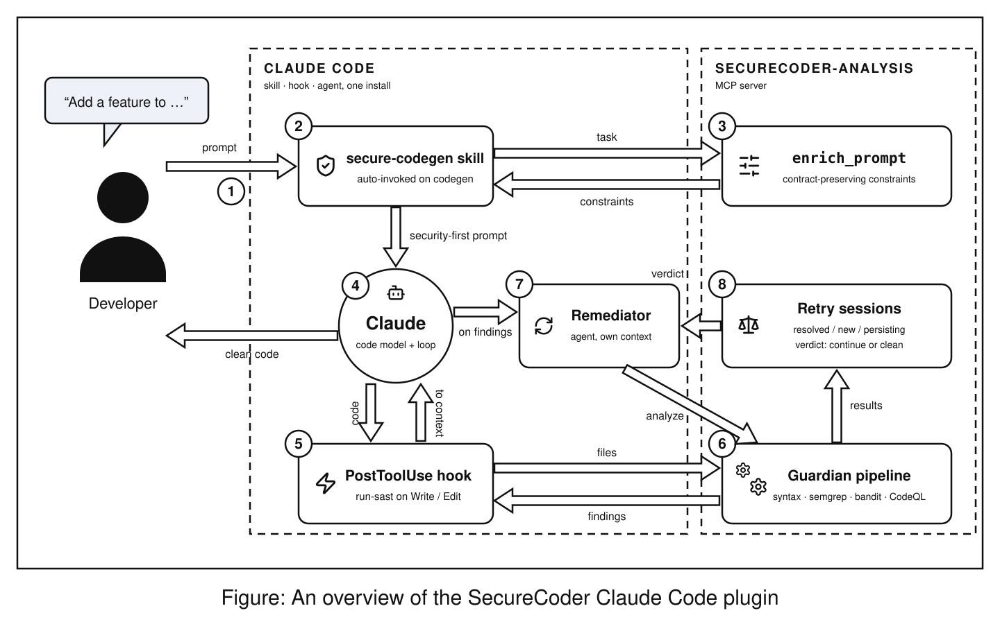

# SecureCoder — Claude Code Plugin

Security-aware code generation pipeline for Claude Code. Combines prompt-level constraint injection, post-write SAST feedback, and an iterative remediation agent into a single installable plugin.

The analysis backend is a **zero-dependency Node MCP server** (`mcp-server/`) ported from the [SecureCoder](https://github.com/STG-TuDA/SecureCoder) Kotlin engine (the same engine behind the IntelliJ plugin): CodeQL orchestration with query-pack fallback and crash-recovery heuristics, syntax hard-reject guardians, semgrep/bandit adapters, per-rule remediation guidance, and retry-policy bookkeeping.

## What it does



## MCP tools (`securecoder-analysis` server)

| Tool | What it does |
| --- | --- |
| `securecoder_analyze` | Runs the guardian pipeline on files. Fast guardians always; `deep: true` adds CodeQL (security-extended suites, minutes). Returns violations, per-rule remediation guidance with code snippets, and — given a `session` id — retry-loop verdicts (`continue` / `meta_review` / `hard_limit_exhausted` / `hard_reject` / `clean`). |
| `securecoder_enrich_prompt` | Heuristic prompt enricher: appends contract-preserving security constraints to a code-generation prompt. |
| `securecoder_reset_session` | Resets a remediation session's attempt counter. |
| `securecoder_status` | Reports analyzer availability (codeql/semgrep/bandit/clang/…) and the effective config. |

What was ported from the Kotlin engine, and what maps onto Claude itself:

| SecureCoder (Kotlin) | Here |
| --- | --- |
| `CodeQLGuardian` / `CodeQLRunner` / `SarifParser` / `LanguageDetector` | `mcp-server/lib/codeql.js`, `sarif.js`, `languages.js` |
| `{Python,JavaScript,Go,C,Cpp}SyntaxGuardian` (hard-reject) | `mcp-server/lib/syntax.js` |
| `GuardianExecutor` (parallel run, failure isolation) | `mcp-server/lib/analyze.js` |
| `FeedbackBuilder` (rule hints, snippets, dedup) | `mcp-server/lib/feedback.js` |
| `HeuristicPromptEnricher` | `mcp-server/lib/enricher.js` |
| `GuardianRetryPolicy` + `GuardianRetryDecider` (data prep) | `mcp-server/lib/retry.js` — the *decision* LLM is Claude itself |
| `WorkflowEngine` generate→analyze→fix loop | Claude Code itself (skill + hook + remediator agent) |
| `LlmViolationTriage`, `SelfTestLoop` | Claude (the remediator triages findings in-context) |

## Installation

```bash
# From a local directory (dev/testing)
claude --plugin-dir ./securecoder-claude-plugin

# After publishing to a marketplace
/plugin install <your-marketplace>@securecoder
```

Requirements: Node ≥ 18 (bundled server has zero npm dependencies). Optional analyzers picked up automatically if on PATH: `codeql` (with query packs, e.g. `codeql pack download codeql/python-queries`), `semgrep`, `bandit`, `clang`, `gofmt`.

Check your setup from within Claude Code: ask it to call `securecoder_status`.

Running from a checkout and testing the hooks safely in Claude Code's sandbox: see [docs/DEVELOPMENT.md](docs/DEVELOPMENT.md).

## Usage

**Automatic**: just use Claude Code normally. The skill auto-invokes on code generation tasks, the hook fires on every file write.

**Manual / explicit pipeline**:

```
/securecoder:secure-codegen [optional: security context e.g. "PCI-DSS scope"]
```

**Deep scan on demand**: ask Claude to "run a deep SecureCoder analysis on <files>" — it calls `securecoder_analyze` with `deep: true`.

## Configuration

Place `.securecoder.json` at your repo root (all keys optional; defaults in `mcp-server/lib/config.js`):

```json
{
  "analyzers": ["syntax", "semgrep", "bandit"],
  "deep_analyzers": ["codeql"],
  "semgrep_config": "p/owasp-top-ten",
  "exclude_patterns": ["tests/", "node_modules/"],
  "retry": { "soft_limit": 7, "hard_limit": 14 },
  "codeql": {
    "binary": "codeql",
    "languages": null,
    "query_packs": { "python": ["my/custom-pack:suite.qls"] },
    "ram_mb": 2048,
    "timeout_seconds": 600
  },
  "bins": { "python": "python3", "semgrep": "semgrep" }
}
```

`codeql.query_packs` entries are prepended to the built-in per-language candidates (code-scanning suite, then security-extended fallback). Environment overrides: `CODEQL_BIN`, `SECURECODER_CONFIG`, `PYTHON_BIN`, `NODE_BIN`, `SEMGREP_BIN`, `BANDIT_BIN`, `CLANG_BIN`, `CLANGXX_BIN`, `GOFMT_BIN`.

## Plugin structure

```
securecoder-claude-plugin/
├── .claude-plugin/
│   └── plugin.json                  # manifest + metadata
├── .mcp.json                        # registers the securecoder-analysis MCP server
├── mcp-server/
│   ├── index.js                     # MCP stdio server (zero dependencies)
│   ├── cli.js                       # same pipeline as a CLI, used by the hook
│   └── lib/                         # ported guardian pipeline (see table above)
├── skills/
│   └── secure-codegen/SKILL.md      # constraint injection + self-review
├── agents/
│   └── securecoder-remediator.md    # iterative SAST feedback loop agent
├── hooks/
│   └── hooks.json                   # PostToolUse (fast SAST) + PreToolUse (shell warn)
├── bin/
│   └── run-sast                     # hook adapter → mcp-server/cli.js
├── .securecoder.json                # example project config
└── settings.json
```

## Relationship to the IntelliJ plugin

Both frontends share the same pipeline design. The IntelliJ plugin drives the Kotlin `WorkflowEngine` with its own LLM client; here Claude is the LLM and the agentic loop, and the classical parts of the engine (guardians, feedback construction, retry policy) run in the MCP server. Guardian behavior (query packs, failure heuristics, feedback text) is kept in sync with the Kotlin sources under `SecureCoder/guardian` and `SecureCoder/engine`.

## Further reading

- [docs/DEVELOPMENT.md](docs/DEVELOPMENT.md) — running from a checkout, sandboxed hook testing, CI-style non-interactive runs.
- [docs/semgrep-guardian-comparison.md](docs/semgrep-guardian-comparison.md) — how this pipeline compares to Semgrep's own MCP/hook-based "Guardian" plugin.

## Publishing

```bash
# Validate before submitting
claude plugin validate .

# Submit to community marketplace
# → https://claude.ai/settings/plugins/submit
```
